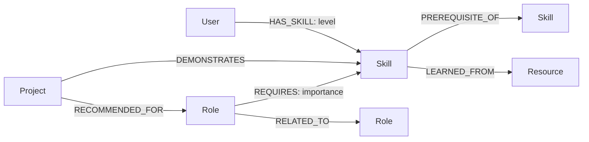

# CareerGraph — AI-Powered Career & Skill Graph Explorer

**Live demo:** Not currently deployed.

CareerGraph helps learners understand how their current skills connect to job roles, prerequisites, portfolio projects, and learning resources. It is a React application backed exclusively by CognoDB Cloud via the official Neo4j JavaScript driver.

## Features

- Browse 15 engineering, data, AI, cloud, and security roles.
- Trace multi-hop prerequisites and shortest learning paths; cross-domain goals include an explicit domain-switch step and a target-side prerequisite trail when available.
- Select one of eight learner profiles to see role readiness and skill gaps.
- Add and remove profile skills, or update proficiency; readiness and graph reachability refresh from the saved profile.
- Browse and add courses, mapping each course to any relevant skills in the graph.
- Match portfolio projects to target-role skills.
- Explore a focused, interactive role / skill / project relationship graph.
- Friendly loading, empty, API failure, and database-unavailable states.

## Why a graph database?

This is relationship-first data, not CRUD with a different storage engine. A role has many required skills; each skill unlocks other skills, is demonstrated by projects, and is learned from resources. Users add their own skill relationships.

For example, “What can Maya target within three prerequisite hops?” follows `User → HAS_SKILL → Skill → PREREQUISITE_OF* → Skill ← REQUIRES ← Role`. Profiles can add skills and set proficiency (Beginner, Working knowledge, Proficient, or Advanced), changing recommendation and reachability results. Courses are stored as resources and linked to every skill they teach; adding a course makes it visible in role learning resources when those skills are required. “Which project proves the largest part of a role?” traverses `Role ← REQUIRES → Skill ← DEMONSTRATES ← Project`. In a relational model these require several join tables, recursive CTEs, row de-duplication, and application-side path assembly. CognoDB represents those connections directly and openCypher has first-class variable-length traversal.

## Data model



The seed includes 15 roles, 40 skills, 20 projects, 25 resources, and 8 sample profiles. Every seeded node is tagged `seed: 'careergraph'`, so reset affects only this application's data.

## Key Cypher queries

| Query              | Inputs / results                      | Graph benefit                                        |
| ------------------ | ------------------------------------- | ---------------------------------------------------- |
| Role skills        | `roleId` → required skills            | Typed edge traversal.                                |
| Prerequisite trail | `skillId` → 1–4 hop trails            | `[:PREREQUISITE_OF*1..4]` supports unknown depth.    |
| Missing skills     | `userId`, `roleId` → gaps + resources | Compares user/role edges and continues to resources. |
| Learning path      | start, target → shortest skill path   | Returns actual intermediate graph nodes.             |
| Project coverage   | `roleId` → projects + matched skills  | Intersects relationships through skill nodes.        |
| Reachable roles    | `userId` → 0–3-hop roles + coverage   | The explicit relationally awkward traversal.         |

All Cypher is parameterized; no user input is concatenated into a query.

Course creation is intentionally open and has no authentication or ownership checks. If deploying this API publicly, add authentication and authorization or otherwise restrict `POST /api/courses` before exposing it.

## Local setup

1. Create a free C0 database at [CognoDB Cloud](https://console.cognodb.com/signup).
2. Copy `.env.example` to `.env` at the repository root and fill in the CognoDB Bolt URI, `cognodb` username, and generated password.
3. Install, seed, and run:

   ```bash
   npm run install:all
   npm run seed
   npm run dev
   ```

Open `http://localhost:5173`. Use `npm run test` for API safety tests and `npm run build` for the production client build.

## Deployment

Deploy `server` to Render/Railway with `npm install` and `npm start`; set `COGNODB_URI`, `COGNODB_USERNAME`, `COGNODB_PASSWORD`, and `CLIENT_ORIGIN` as backend-only secrets. Deploy `client` to Vercel (build `npm run build`, output `dist`) and proxy `/api` to the backend. Never expose Bolt credentials as Vite environment variables. Production flow: **Browser → Vercel React app → Express API → CognoDB Cloud**.

## Screenshots and demo

Screenshots are deliberately not fabricated. Capture Dashboard, Role Explorer, Role Details, Career Path, and My Career views after running the app; place them in `docs/screenshots/`. Follow [the demo script](docs/DEMO_SCRIPT.md) for a focused 3–5 minute recording.

## Security and structure

Helmet, CORS, environment variables, sanitized error middleware, and parameterized Cypher are used throughout. The frontend never sees database credentials. `server/config/database.js` owns driver/session lifecycle; `server/queries/` owns graph queries; controllers remain thin.

```text
client/src/{components,pages,services}  React application
server/{config,controllers,queries,routes,middleware}  REST + graph layer
scripts/seed.js                         idempotent CognoDB data loader
docs/                                   architecture, demo notes, screenshots
```
